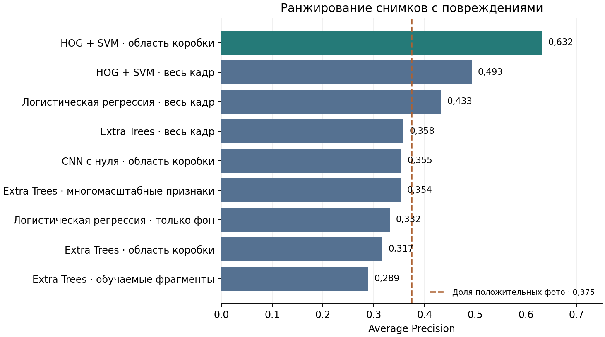

# Повреждения посылок · расширенный эксперимент

Источник — [Corrugated Cardboard Boxes Dataset](https://github.com/chanllon/corrugated-cardboard-boxes-dataset). Это фотографии физических коробок. Часть повреждений авторы нанесли намеренно. Положительный класс — наличие размеченного видимого дефекта в кадре. Кадр без рамки считается отрицательным для этого эксперимента, а состояние остальных сторон остаётся неизвестным.

## Как устроена проверка

Сохранены 42 снимка первого пилота. Для каждого нового префикса рассмотрены четыре наименьших по размеру файла, затем выбраны три. При наличии обеих меток включался хотя бы один кадр с размеченным дефектом и один без него. Выборка не отражает частоту повреждений в реальном потоке. Хеши, источник и разбиение сохранены в `real_expanded_index.csv`.

Все фотографии одного префикса находятся в одной части выборки. Итоговый тест состоит из восьми префиксов, которых не было в первом пилоте. Модель выбиралась по среднему AP четырёх фолдов на остальных префиксах. Префиксы — группы из имён файлов. Их соответствие физическим коробкам источник явно не документирует.

При обрезке используется внешняя рамка коробки из исходной разметки. Для применения к клиентскому фото такой рамке нужен отдельный источник, например детектор коробок. В модели по фрагментам разметка дефекта используется для создания обучающих меток фрагментов. На тесте оценка кадра — максимум по фрагментам. Рамка тестового дефекта используется для измерения локализации и размера.

CNN обучалась с нуля. Во всех фолдах использовались 16 эпох, горизонтальные отражения и изменение яркости, без подбора по тесту. Результаты последующего сравнения с предобученной MobileNetV3 и автоматической рамкой опубликованы в [итоговом отчёте](FINAL_RESULTS.md).

## Результаты

Проверены 156 фотографий из 52 групп. На разработку выделено 132 фото из 44 групп, на тест — 24 фото из 8 групп. В итоговом тесте 9 положительных кадров, поэтому AP для постоянного скоринга равна 0,375.

| Подход | Средняя AP по фолдам разработки | AP на тесте | ROC-AUC на тесте | Мелкие дефекты в первых 12 кадрах |
|---|---:|---:|---:|---:|
| Логистическая регрессия · весь кадр | 0,503 | 0,433 | 0,496 | 4 из 7 |
| Extra Trees · весь кадр | 0,398 | 0,358 | 0,444 | 2 из 7 |
| Extra Trees · область коробки | 0,407 | 0,317 | 0,296 | 1 из 7 |
| HOG + SVM · весь кадр | 0,480 | 0,493 | 0,430 | 3 из 7 |
| HOG + SVM · область коробки | 0,361 | 0,632 | 0,674 | 4 из 7 |
| Extra Trees · многомасштабные признаки | 0,448 | 0,354 | 0,356 | 2 из 7 |
| Extra Trees · обучаемые фрагменты | 0,407 | 0,289 | 0,244 | 3 из 7 |
| CNN с нуля · область коробки | 0,411 | 0,355 | 0,370 | 3 из 7 |
| Логистическая регрессия · только фон | 0,382 | 0,332 | 0,363 | 2 из 7 |



- **Выбранная по фолдам модель — логистическая регрессия по всему фото.** Приближённый 95%-ный групповой бутстрэп-интервал её тестового AP: 0,246–0,669. Интервал характеризует изменчивость на этих восьми группах.
- **HOG + SVM по коробке дала максимальную AP на итоговом тесте.** На фолдах разработки её средняя AP была ниже, чем у версии по всему кадру. Для выбора этого варианта нужна новая выборка, где рамку предоставляет детектор коробки.
- **Фрагменты дали подсказку для локализации.** Самый высокооценённый фрагмент перекрывал размеченный дефект по правилам эксперимента на 5 из 9 положительных кадров. Максимум по фрагментам слабо ранжировал обращения по сравнению с базовой моделью.
- **Контроль по фону дал AP 0,332.** Для него использованы только цветовые гистограммы пикселей вне рамки коробки. Контроль исключён из выбора модели. Минимальное расстояние dHash между разработкой и тестом — 7 из 64 бит. Визуальная проверка трёх ближайших пар показала похожий фон и разный вид коробок. Это не подтверждает независимость мест съёмки.

Мелким здесь считается дефект, у которого наибольшая размеченная область занимает менее 3% площади внешней рамки коробки. В верхнюю половину ранжирования попадают 12 из 24 фото. Количество найденных мелких дефектов при этом бюджете показывает пользу ранжирования для оператора и не оценивает автоматическое закрытие обращений.

## Повторить

```bash
python -m pip install -r requirements-expanded.txt
python real_advanced.py data/real --download
```

Если снимки уже скачаны, передай каталог с JPG и опусти `--download`. Скрипт проверяет соответствие SHA-256. Отчёт и предсказания записываются в `run/real-expanded/`. Результаты проведённого прогона сохранены в `example-results/expanded/`. Команды для независимого многокадрового теста по-прежнему находятся в [REAL_DATA.md](REAL_DATA.md).
